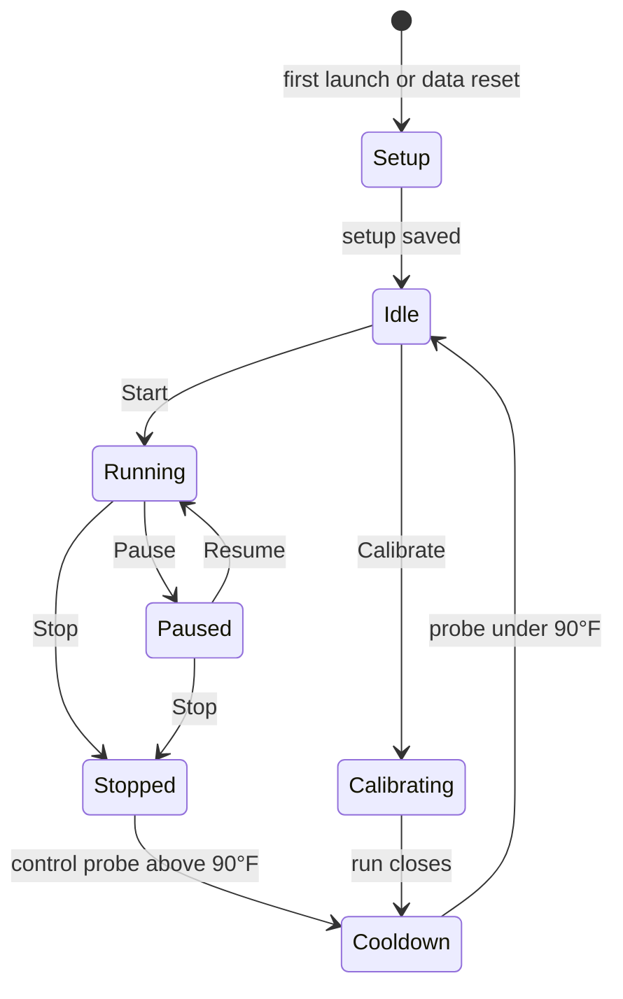

# Brewski

Local web controller for a small still. A Python program runs the heater logic and stores every run. A plain JavaScript dashboard, in a dark layout, shows live temperatures, heater state, and the history of those runs.

The installed controller drives the live Pi wiring: the heater SSRs, the MAX31865 still probes, and the HTS221 cabinet sensor. `brewski dev` on a Mac uses a **dummy source** that simulates a still, so the dashboard can be built without that hardware. The installed service never falls back to the dummy source.

| Where | Command | Open |
| --- | --- | --- |
| Mac | [`brewski dev`](#develop-on-a-mac) | http://127.0.0.1:5173 |
| Raspberry Pi | [install script](#install-on-a-raspberry-pi) | `http://<pi-address>:8080` |

## Contents

- [What a run does](#what-a-run-does)
- [Emergency codes](#emergency-codes)
- [Raspberry Pi](#raspberry-pi)
- [Dummy source](#dummy-source)
- [Develop on a Mac](#develop-on-a-mac)
- [Install on a Raspberry Pi](#install-on-a-raspberry-pi)
- [What is stored](#what-is-stored)
- [Layout](#layout)

## What a run does

A run is one session of the still.



### First launch

A new controller, and one that has just had all data reset, opens a setup overlay. It asks for the heaters, the probes, the panel pins, the SPI and I2C bus, the target temperature, and the still size in gallons. A normal run stays locked until a calibration has measured the coast.

### Idle

The probes still report temperature. Heaters are off.

While Brewski is running, including idle and pause, a timeline reading is saved about every 5 seconds. The dashboard chart follows the last 20 minutes of that clock. Drag or scroll to move back through it, and step the window through fixed lengths: 5 minutes, 20 minutes, 1 hour, and on up to 5 years. A hole longer than 30 minutes, from the controller being off, is drawn as a two-minute break.

### Start

Brewski copies the current setup onto the run: target temperature, which heaters and probes are enabled, their names, and their GPIO pins. The clock starts at zero.

Starting during a cooldown marks that cooldown interrupted. It stays on the previous run and is left out of the average. Start is refused until a calibration has been saved. An older coast that has no full model still allows a run on the earlier cutoff.

### Running

About once a second the controller reads the probes. **The first enabled probe is the only one that controls the heaters.** Any enabled probe after it is logged and charted only.

Once a calibration has saved the full model, the elements stay on until the predicted crest reaches the dial target. That prediction plays the exponential soak, then the straight heating rate, then the leveling coast. There is no extra margin under the target.

Until that model exists, heaters turn off by the measured coast, sooner when the recent rise is faster, and only the fraction of the coast a cold sheath has stored.

- Without a measured cooling rate, they turn back on when the probe falls 2°F below that coast.
- Once a cooling rate is known but the exponential model is not, a run still turns off at that coast, then uses one short pulse when the probe sags about 1°F.

While the pot is rising, Brewski estimates how long until the target, including the coast after the SSR opens. While it is falling, Brewski estimates how long until the control probe is under 90°F. Both show on the status payload, the LCD target line, and the sample log.

A heater that has just turned on stays on for at least the minimum on time, and one that has just turned off stays off for at least the minimum off time (each 1 second unless changed). Both dwells keep a zero-crossing SSR from chattering. Pause and Stop still turn the heaters off immediately. Disabled heaters stay off.

Every 5 seconds a sample is saved: each probe temperature, each heater on or off, and the target at that moment.

### Pause

Heaters are forced off and the run clock stops. Live temperatures are still shown. Paused time is not added to the log.

### Stop

Heaters turn off, the run is closed as **Stopped**, and the setup snapshot plus the sample log stay in the history.

### Calibrate

From the dashboard, with the pot filled with water. Calibrate does not use the run's target temperature, and it does not change that setpoint. The chart marks **Start**, then each stage below, then **Cooldown**. The LCD names the same stages, opening with **Settle** and closing, after the run, on the saved coast and the cooling rate.

| Stage | What happens |
| --- | --- |
| Settle | Three seconds with the elements off. |
| Initial heating | Learns the exponential soak. |
| Linear heating | Learns the straight rate. Heaters open while the probe is still under 140°F. |
| Coasting | Heaters off. Learns the negative exponential up to equilibrium. |
| Adjusted | Equilibrium is scored against 140°F. Short of it lowers the stored rise. High of it raises the rise. |
| Pulse | One predicted pulse climbs toward 160°F and stays on until opening now would crest at 160°F. A shorter pulse follows only when that coast lands short. |
| Holding | Keeps 160°F for ten minutes. Opens before the probe reaches 160°F so the coast finishes on the target. |

A later calibration is averaged into the model already saved, one equal share per run. Clean Calibration, after a confirmation, erases that model and locks normal runs until the next calibration. Past runs stay in the history.

After the run closes, a full pass over the samples can revise the model for the next run. That pass uses Grok when `GROK_API_KEY` is set, and the local fit stands when the key is missing or the answer is far from the math. The heater loop never waits on it.

The calibration uses the still size from setup. A different size scales rates and rises, not the soak or coast time constants.

Calibration runs stay in the log with their own badge and are left out of the run count, average duration, average cooldown, and the per-run heater-on totals. They still add to each element's hour meter, because the element was powered.

### Cooldown

A cooldown is the stretch after a run while the control probe is still above 90°F. Timing starts the first time the control probe reaches the aim during the run, and also when Stop finds the probe above 90°F even if the aim was never reached. Heaters stay off. The cooldown ends when the probe falls under 90°F. Those readings stay on the dashboard chart, and the time is saved.

A power cut resumes an open cooldown. The dashboard and the LCD estimate how long until the probe is under 90°F from the live falling slope, or from the learned cooling rate. The dashboard and the history page show the average of every finished cooldown.

Starting a new run marks the open cooldown interrupted. A stop at or under 90°F does not open one.

### Changes during a run

Each heater and each probe can be enabled or disabled on its own. Changing names, which devices are enabled, a heater's GPIO pin, a probe's MAX31865 chip select, RTD, wire count, or reference resistor, or any other GPIO pin, is locked while a run is open.

The target temperature, the cabinet limit, and the minimum on and off times can still be changed. Later samples record the new target, and the run keeps the target it started with. The target dial on the panel changes that same target by 1°F, from 90 to 240.

### Cabinet interlock

The HTS221 is not a process temperature. It watches the cabinet. If it is enabled and the cabinet rises above the cabinet limit (170°F unless changed, allowed from 100 to 200), Brewski opens every SSR immediately, stops and saves an open run, and refuses Start until the cabinet is back at the limit. The controller process keeps running so the SSR pins stay driven off.

Humidity is shown and does not trip the stop. Disabling the HTS221 turns the interlock off.

## Emergency codes

`src/brewski/emergency.py` is the only list. A new fault takes the next number there and a line here. Numbers are not reused. The LCD shows the lowest active code. The dashboard and the status strip show every active code and its sentence. Heaters stay off and Start stays refused while any code is active.

| Code | Meaning |
| --- | --- |
| `E01` | Cabinet temperature is above the cabinet limit. |
| `E02` | The HTS221 is enabled and does not answer. |
| `E03` | The control probe faulted or did not answer. |
| `E04` | The SPI bus did not open, or the saved SPI pins are not the hardware bus. |

## Raspberry Pi

`brewski` with no command, including the systemd service, uses `src/brewski/sources/pi.py`. There is no switch back to the dummy source. A missing still probe or a failed SPI open leaves that reading empty and keeps every SSR off. A missing HTS221 trips the cabinet emergency only when that sensor is enabled.

The status payload includes `"source": "pi"`. The dashboard badge reads **Pi**.

### Default BCM pins

Every pin in this map must be unique and from BCM 2 to 27. Setup can change them. The [Pi hat](hardware/pi-hat.md) is wired to these defaults.

| Signal | BCM | Notes |
| --- | --- | --- |
| Heater 1 SSR | 12 | Active high. |
| Heater 2 SSR | 16 | Active high. |
| Probe 1 chip select | 17 | Enabled. 2-wire PT100, 430 Ω reference. |
| Probe 2 chip select | 8 | Starts disabled. Same probe defaults. |
| SPI CLK | 11 | Hardware SPI0. |
| SPI SDO | 9 | MISO. |
| SPI SDI | 10 | MOSI. |
| I2C SDA | 2 | HTS221 and LCD enabled. |
| I2C SCL | 3 | Hardware I2C bus. |
| Encoder A | 27 | Target dial, 1°F per step. |
| Encoder B | 22 | |
| Start lamp relay | 24 | Solid on only while Start will do something. |
| Stop lamp relay | 23 | See the hold behavior below. |
| Start button | 5 | |
| Stop button | 6 | |

### Heaters, probes, and the cabinet sensor

- **SSRs.** gpiozero outputs on each heater's BCM pin, active high. Forced off on startup, shutdown, pause, stop, a control-probe fault, and any emergency code.
- **MAX31865.** Hardware SPI0 only when the saved pins are CLK 11, MOSI 10, and MISO 9. Chip select is a separate GPIO. The driver uses the saved wire count, PT100 or PT1000 type, and reference resistor. Any other SPI pin set is left unread.
- **HTS221.** smbus2 on I2C bus 1 at `0x5F`, only when the sensor is enabled and SDA/SCL are BCM 2 and 3.

### Panel

The LCD is a 20×4 I2C display on the saved SDA and SCL pins, after setup. It probes `0x27`, then `0x3F`. Saved BCM 2 and 3 use the Pi's hardware bus. I2C addresses are not stored.

The running controller keeps the start and stop buttons, their LED relays, and the target encoder open. An LED is solid on only while that button will do something. While Stop is held, its lamp stays dark until the hold is long enough, then comes on, and goes out again when the button is released. The boot update prompt turns both LEDs on and does not blink them.

After the controller is up, the LCD shows the mode and clock, the target, the probe or probes, and both heaters. During a run the target line also shows the estimated time to the target, or the estimated time to cool once the pot is falling. During a calibration those first lines name the step: Settle, Initial heating, Linear heating, Coasting, Adjusted, Pulse, Holding, and then the saved coast and cooling rate while the pot cools. A still that has never been calibrated asks for Start. An emergency code replaces that screen until it clears.

Holding Stop for 4 seconds while the still is idle or cooling opens a Software Menu:

| Item | What it does |
| --- | --- |
| About | Brewski and the installed version. |
| Networking | This Pi's address and hostname. The port is on the address line, so the dashboard can be opened from another computer. |
| Test Suite | Live heating tests. The list scrolls, so a later item still fits on the four-line display. |
| Check for Update | Same installer as the dashboard. |
| Reboot | Asks for confirmation, then reboots the Pi. The install grants the service account passwordless `systemctl reboot`. |

The dial moves the highlight, Start chooses it, and Stop goes back. The same hold opens the menu while an emergency code is showing, so the still can be rebooted or updated without the dashboard. The hold is ignored during a run or a pause. A short press of Stop still stops a running or paused run.

**Initial Heating**, in Test Suite, settles for three seconds, leaves the heaters on for three minutes, then off for three minutes, and holds the recording until Stop. It does not change the saved heating model.

Settings has the same About, Check for Update, Reboot, and Test Suite actions. Initial Heating on that card opens the dashboard. End there, or on the dashboard, clears the result the same way Stop does on the panel. Check for Update uses the saved update source. Starting an update covers whichever page is open with an Updating screen and a progress bar until the new version is running. Reboot is refused while a run is open.

The installer enables SPI and I2C and adds the service user to the `spi`, `i2c`, and `gpio` groups. The Pi may need one reboot before `/dev/spidev0.0` appears.

## Dummy source

`DummySource` is only for `brewski dev` on a Mac, and for tests. The status payload includes `"source": "dummy"`. The dashboard badge reads **Dummy source**. Pin numbers for heaters, probes, and SPI are ignored.

Two heaters together lift the boiler from about 70°F toward a 165°F target in a few minutes. That is faster than a real still, on purpose, so the chart moves while the UI is being designed. After the heaters turn off, stored element heat keeps raising the boiler for a few seconds, then it cools back toward room temperature. Sensor 2 lags sensor 1 and sits about 8°F cooler. The cabinet reading stays at room temperature, under the limit.

The contract is `src/brewski/sources/base.py`. The Mac implementation is `src/brewski/sources/dummy.py`.

- `read_temperatures(count)` returns `count` temperatures in °F, sensor 1 first.
- `set_heaters(states)` turns each heater on or off, heater 1 first.

## Develop on a Mac

From a checkout of this repo:

```bash
python3 -m venv .venv
source .venv/bin/activate
pip install -e ".[dev]"
npm install --prefix web
brewski dev
```

- API: http://127.0.0.1:5000
- Dashboard: http://127.0.0.1:5173
- Database: `./data/brewski.db`

The Vite dev server reloads the UI as you edit `web/`, and it proxies `/api` to the Python process. Run the tests with `pytest`.

| Variable | Effect |
| --- | --- |
| `BREWSKI_HOST` | API bind address. |
| `BREWSKI_PORT` | API port. |
| `BREWSKI_DATA_DIR` | Database directory. |
| `BREWSKI_DEV_PORT` | Vite port. Default 5173. |
| `GROK_API_KEY` | Lets a calibration ask Grok for a second reading of each stage. |

Dev can put `GROK_API_KEY` in a local `.env`. The Pi service does not load dotenv: set the key in the service environment if the Pi should call Grok. The key is never written into the repository or into `deploy/brewski.service`.

## Install on a Raspberry Pi

Git is not required. On the Pi:

```bash
curl -fsSL https://raw.githubusercontent.com/anomaddev/Brewski/main/deploy/install.sh | sudo bash
```

That installs the latest GitHub release, then enables a systemd service so the controller starts on every reboot. The database is kept at `/var/lib/brewski/brewski.db`. The service listens on port 8080.

The service runs as the account that invoked `sudo`, or as `pi` when that account exists and sudo did not record a user. Set `BREWSKI_USER` to choose a different account:

```bash
curl -fsSL https://raw.githubusercontent.com/anomaddev/Brewski/main/deploy/install.sh \
  | sudo BREWSKI_USER=still bash
```

From a checkout that is already on the Pi, `sudo ./deploy/install.sh` installs that checkout and does not contact GitHub. Running the script again upgrades Brewski and restarts the service. It does not delete the database. `brewski dev` does not need this install.

### First boot

A fresh boot does not look for an update. The I2C pins are not known until setup saves them, and the LCD stays closed. Finish setup in the dashboard first. That write is stored before any update check. If a newer release exists, the same screen offers it. Update installs that release and keeps the setup that was just saved. Not now leaves the current version running.

### Later boots

Once setup is saved, the next boot turns the LCD on before the network wait and shows startup status there. If the network is still down after that short wait, the installed controller starts.

When a newer release is available and the network is up, the same screen asks before replacing it. Settings chooses the source.

| Source | What gets installed |
| --- | --- |
| **Main** | The latest published release. Default. Commits on `main` stay off the Pi until they are published. |
| **Beta** | The latest commit on the `beta` branch. The LCD shows the installed identity and the new commit, such as `0.6.23 -> abc1234` or `abc1234 -> def5678`. |

Start and Stop are both lit, solid. Start downloads and installs that choice, with each stage on the display. Stop, or a minute with no press, starts the version already on the Pi.

If GitHub cannot be reached, the LCD cannot be opened, or the saved pins are not BCM 2 and 3, Brewski starts the installed version and does not update on its own.

## What is stored

SQLite, one file. There is no separate database server.

### Settings

One row.

| Field | Default | Notes |
| --- | --- | --- |
| Target | | 90–240°F. The panel dial steps by 1°F. |
| Cabinet limit | 170°F | 100–200°F. |
| Still size | From setup | Gallons. Calibration scales rates and rises, not the soak or coast time constants. |
| Update source | `main` | `main` or `beta`. |
| Minimum on / off | 1 second each | Changeable during a run. |
| Heaters | BCM 12 and 16 | Name up to 40 characters, an enable switch, and the SSR pin. |
| Probes | Chip select BCM 17 and 8 | Name is 1 to 11 characters. Probe 2 starts disabled. RTD is `pt100` or `pt1000`, wires are 2, 3, or 4, reference resistor is in ohms. Each probe starts as a 2-wire PT100 with a 430 Ω reference. |
| Buses and panel | See the [pin table](#default-bcm-pins) | SPI, I2C, encoder, lamp relays, buttons. Enable switches for the HTS221 and the LCD. |

Disabling a device keeps its name and wiring. Names, which devices are enabled, and every GPIO pin are locked while a run is open. The target, the cabinet limit, and the minimum on and off times can still be changed.

### Runs

Start time, end time, status (`running`, `paused`, or `stopped`), elapsed seconds (the pause does not add time), and a snapshot of the settings from the moment Start was pressed.

### Samples

Time, elapsed seconds, temperatures, heater states, and the target that was active when the sample was written. Time each heater spent on during a run is estimated from that log and shown on the history page. A sample's heater state is treated as holding until the next sample.

### Control log

Each calibration and each still run keeps a diagnostic log. A line is written about once a second, including while the run is paused and while the pot cools, and also when the heaters change, a calibration stage changes, the heating model is saved, or an analysis result comes back. The line records the control temperature, which heaters are on, and the slope, crest, and coast that decision used.

The run page shows the log. Export downloads a zip of that log as a CSV and the console output captured while the run was open, including cooldown. Resetting data clears both with the runs.

### Timeline

A temperature and the target, about every 5 seconds, for as long as the controller process is running. Run samples stay the log of a run. The timeline is what the dashboard chart scrolls.

| Age | Kept as |
| --- | --- |
| Older than two days | One reading a minute |
| Older than two weeks | One reading every five minutes |
| Older than six months | One reading every half hour |

The first reading, the latest reading, and the readings on either side of a power-off stay. Resetting data clears the timeline with the runs.

### Element hours

Seconds each heater output has actually been on, including calibration and every run. The controller adds that time as it happens and keeps it when run data is reset. The dashboard, the history overview, and Settings show the total in hours.

Replacing an element in Settings zeros that heater so the new one starts at zero. A database from before this meter existed is filled once from its sample log.

## Layout

```
src/brewski/          Python controller, API, and CLI
src/brewski/sources/  Hardware contract, the Pi source, and the Mac dummy still
web/                  Vite dashboard (plain JavaScript, no TypeScript)
deploy/               Pi install script and systemd unit
hardware/             Pi hat spec
tests/
```

`brewski` with no arguments serves the API and, when it has been built, the dashboard. `brewski dev` is the Mac development command described above.
